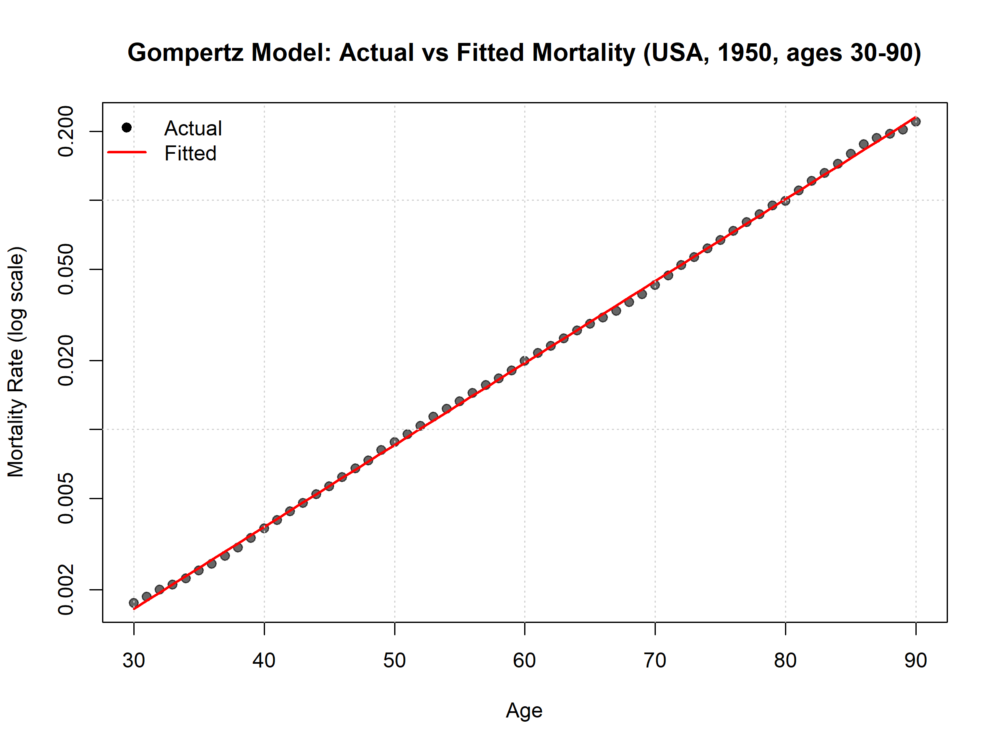
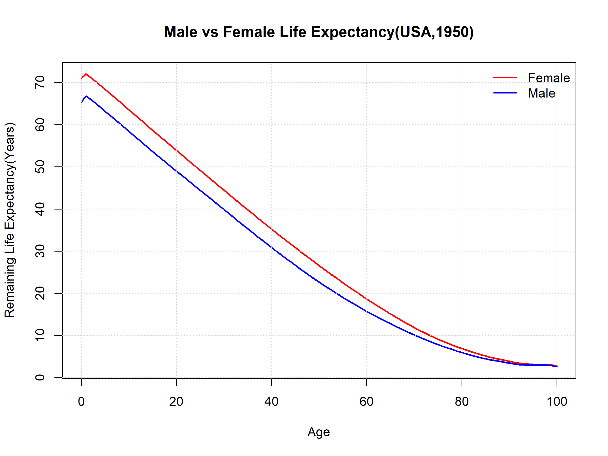
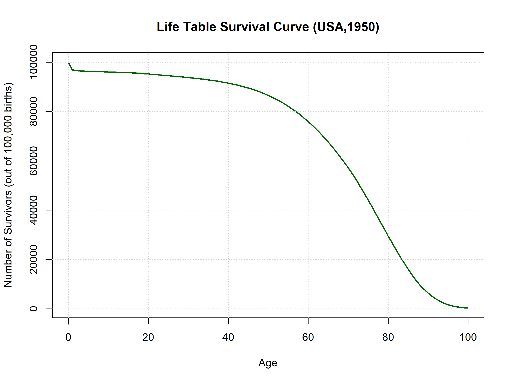

# Life Insurance Mortality Analysis (USA, 1950-1990)

Period life tables and a Gompertz mortality model in R, built from Human Mortality Database data.

## What it does
- Builds period life tables (mx, qx, lx, dx, ex) for 1950, 1970 and 1990
- Compares male and female mortality in 1950
- Fits a Gompertz model to adult mortality (ages 30-90)

## Key results
| Result | Value |
|---|---|
| Life expectancy at birth, 1950 / 1970 / 1990 | 68.1 / 70.7 / 75.4 years |
| Life expectancy at birth, 1950, men / women | 65.4 / 71.0 years |
| Infant mortality rate (mx), 1950 -> 1990 | 3.3% -> 1.0% |
| Gompertz yearly mortality growth factor (c) | 1.086 |
| Mortality doubling time | about 8.4 years |
| Gompertz fit (R-squared) | 0.9996 |

## Method
Central mortality rate mx = deaths / exposure; qx = mx / (1 + (1 - ax) * mx);
survivors lx from a radix of 100,000; life expectancy ex = Tx / lx.
Adult mortality (ages 30-90) is fitted with log(mx) = log(B) + x * log(c) by linear regression.

## How to run
1. Open `Life_Insurance_Mortality_Analysis.Rproj` in RStudio.
2. Install the packages once: `install.packages(c("dplyr", "readr"))`.
3. Run `mortality_analysis.R`. Charts go to `plots/` and tables to `outputs/`.

## Limitations
- Uses the standard approximation ax = 0.5 (0.1 for infants).
- Data above age 90 are sparse, so results there are noisy.
- Only three years are compared.
- The Gompertz fit is an unweighted regression on the log scale.

## Data
Human Mortality Database. University of California, Berkeley, and Max Planck Institute
for Demographic Research. www.mortality.org
Licensed under CC BY 4.0. The two USA files used (Deaths_1x1.txt and Exposures_1x1.txt)
are included in `data/`.