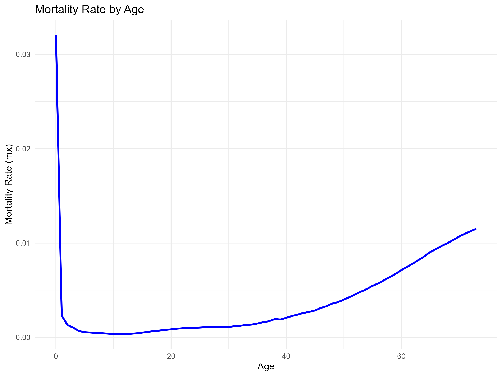
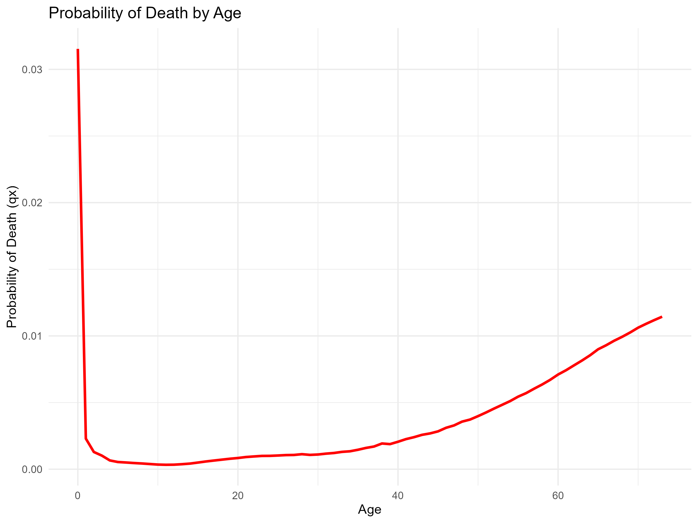
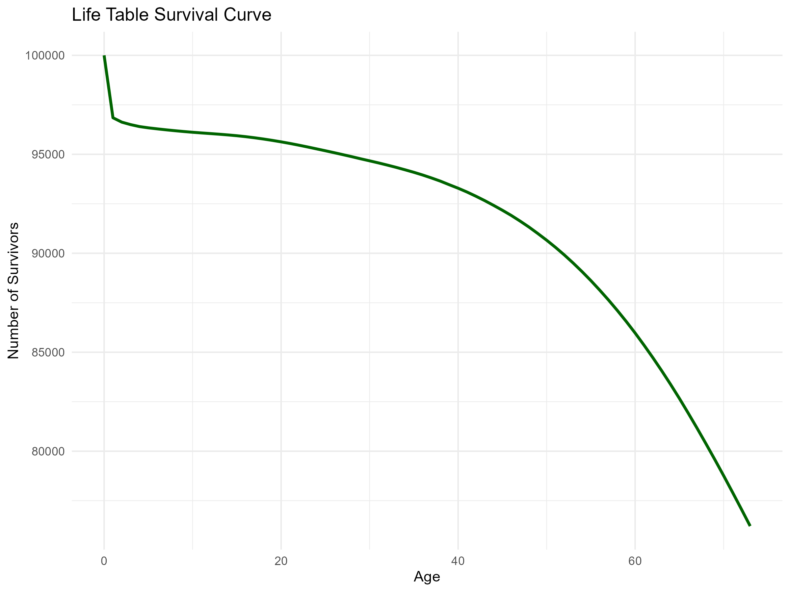
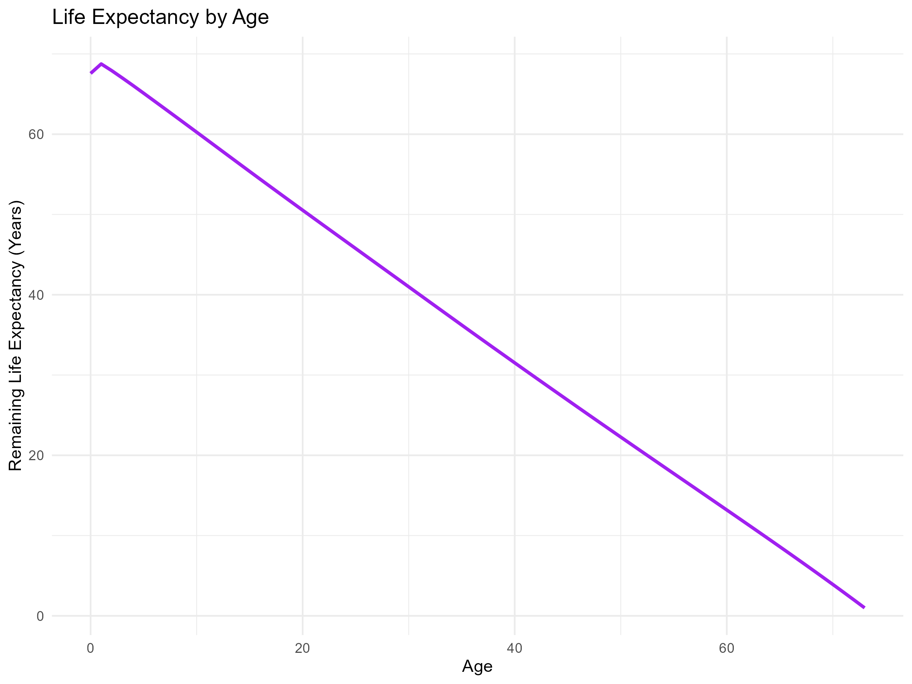

# Life-Insurance-Mortality-Analysis
Mortality analysis and life table construction using R

## 1. Project Overview

This project focuses on analysing life insurance mortality data for the year 1950 using R programming.

The analysis uses historical death and exposure datasets to calculate age-specific mortality rates, construct an actuarial life table, estimate survival probabilities, and calculate remaining life expectancy at different ages.

The project demonstrates the application of actuarial mathematics, data manipulation, statistical analysis, and data visualisation in the context of life insurance.

## 2. Project Objectives

Analyse mortality patterns across different age groups.

Calculate central mortality rates and probabilities of death.

Construct a life table using an initial hypothetical population of 100,000 individuals.

Calculate the number of survivors and deaths at each age.

Estimate person-years lived and remaining life expectancy.

Visualise mortality and survival patterns using R.

## 3. Tools and Technologies

| Category | Tools |
|---|---|
| Programming Language | R |
| Development Environment | RStudio |
| Data Manipulation | dplyr, tidyverse |
| Data Visualisation | ggplot2 |
| Data Import | readr |
| Data Formats | TXT, CSV |

## 4. Dataset Description

The analysis uses two historical datasets:

1. **Deaths Dataset**: Contains the number of deaths by age and calendar year.

2. **Exposure Dataset**: Contains the corresponding exposure values used to calculate mortality rates.

The datasets are cleaned and combined using age as the common variable.

Dataset specifications:

-Selected Year: 1950

-Age Range: 0–73 years

-Initial Life Table Population: 100,000 individuals

## 5. Methodology

The project follows these steps:

1. **Data Importing**: Import death and exposure datasets into R.

2. **Data Cleaning**: Extract numerical age values, handle missing observations, and select the year 1950.

3. **Data Integration**: Merge both datasets using age.

4. **Mortality Rate Calculation**: Calculate the central mortality rate for each age.

5. **Life Table Construction**: Calculate the probability of death, probability of survival, number of survivors, and number of deaths at each age.

6. **Life Expectancy Calculation**: Calculate person-years lived, total future person-years, and remaining life expectancy.

7. **Data Visualisation**: Create graphs to understand mortality and survival patterns.

8. **Results Export**: Export the calculated life table and selected-age summary into CSV files.

## 6. Actuarial Formulas Used

The following actuarial formulas are used:

1. **Central Mortality Rate**
(mx)=Deaths/Exposure

2. **Probability of Death**
(qx)=mx/(1+(1-ax)*mx)

3. **Probability of Survival**
(px)=1-qx

4. **Number of Survivors**
(l(x+1))=lx*px

5. **Number of Deaths**
(dx)=lx*qx

6. **Person-Years Lived**
(Lx)=lx-(1-ax)*dx

7. **Total Future Person-Years**
(Tx)=Sum of future Lx values from age x onwards

8. **Remaining Life Expectancy**
(ex)=Tx/lx

An initial population of 100,000 individuals is assumed, and ax is taken as 0.5 for the one-year age intervals.

## 7. Project Visualisations

The project includes four visualisations:

1. **Mortality Rate by Age**

Illustrates how central mortality rates vary across different ages.

2. **Probability of Death by Age**

Shows the probability of an individual dying between age x and age x+1.

3. **Life Table Survival Curve**

Demonstrates the decline in the surviving population from the initial cohort of 100,000 individuals.

4. **Life Expectancy by Age**

Illustrates the remaining life expectancy at different ages based on the constructed life table.

## 8. Key Observations

1. Mortality rates are relatively high during infancy.

2. Mortality decreases significantly during childhood.

3. Mortality rates gradually increase with advancing age.

4. The number of survivors decreases as age increases.

5. Remaining life expectancy generally declines with age, with a possible initial increase due to higher infant mortality.

## 9. Results and Outputs

The project generates two primary CSV outputs:

| Output File | Description |
|---|---|
| `Life_Table_1950.csv` | Contains the calculated actuarial life table values. |
| `Life_Expectancy_Summary.csv` | Contains selected-age life expectancy indicators. |

These files can be used for further statistical analysis, comparisons, and actuarial applications.

## 10. Project Limitations

-The analysis is currently restricted to the year 1950.

-The life table covers ages 0–73 due to limitations in the available exposure data.

-Life expectancy estimates are based on this restricted age range and should not be interpreted as complete life expectancy estimates.

-A constant ax assumption of 0.5 is used for the one-year age intervals.

-The analysis is based on historical mortality data and does not represent current mortality patterns.

## 11. Future Scope

-The project can be extended through:

-Comparing mortality patterns across multiple calendar years, including 1960 and 1970.

-Analysing changes in life expectancy over time.

-Comparing survival curves across different years.

-Extending the life table to older ages when suitable exposure data is available.

## 12. Repository Contents

**Project 1.R** – R script containing the mortality analysis.

**Life_Table_1950.csv** – Calculated actuarial life table.

**Life_Expectancy_Summary.csv** – Summary of life table indicators at selected ages.

**plots/** – Folder containing project visualisations.

**data/** – Folder for source datasets, subject to redistribution permissions.

## 13. Author

Devansh Mittal

Actuarial Science | R Programming | Mortality Analysis | Data Analytics
